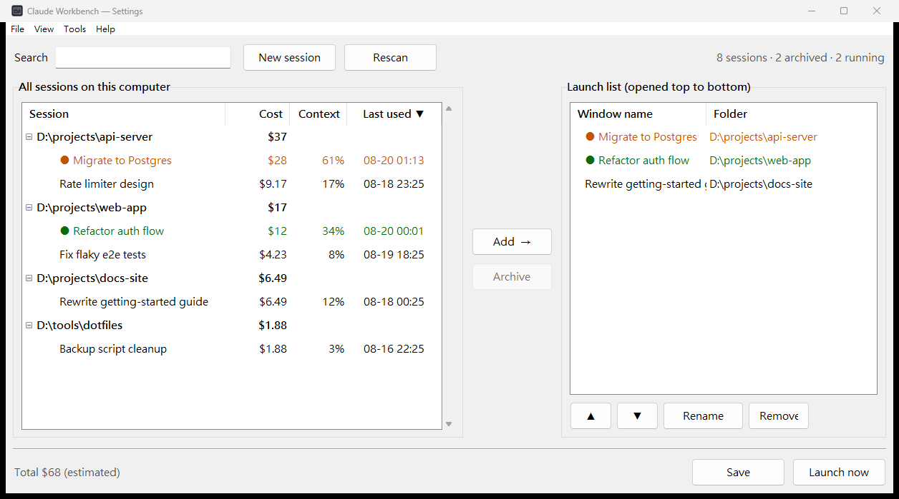

# Claude 工作台（Claude Workbench）

[](https://github.com/Moaijay/claude-workbench/actions/workflows/tests.yml)

[English](README.md) · 繁體中文

把固定的幾個 Claude Code 對話各自開在獨立的終端機視窗，直接接續上次的進度。
也可以當成 `claude --resume` 選單的替代品：全機所有對話都在同一個視窗裡，雙擊即開。

> 非官方社群工具，與 Anthropic 無關，亦未獲其背書。
> Claude 與 Claude Code 為 Anthropic 之商標。



## 安裝

```
git clone https://github.com/Moaijay/claude-workbench
cd claude-workbench
python install.py
```

或下載 ZIP，在解壓出的資料夾內執行 `install.py`（在任何目錄用完整路徑
執行也可以——指令碼一律以自己檔案的位置定位）。

它會產生圖示並在桌面建立兩個捷徑，OneDrive 重導向的桌面也能正確找到。
`python install.py --uninstall` 移除捷徑與開機自啟，之後刪掉資料夾即
完全清除。

需求：Windows、Python 3.8 以上（只用內建 tkinter）、已安裝 Claude Code。
`claude` 執行檔從 PATH 或 `~\.local\bin` 尋找；裝在別處時在
`config.json` 的 `"claude"` 指定。

## 更新

- git clone 取得的：資料夾內執行 `git pull`。
- 下載 ZIP 的：重新下載、解壓覆蓋原資料夾。

兩種方式都不影響使用者資料：`config.json` 不在版本庫中，
快取、記錄檔與備份在 `%LOCALAPPDATA%\ClaudeWorkbench`。

`說明 → 檢查更新` 與 GitHub 最新版比對版本 —— 僅在點擊時連線；
本工具平時不發任何網路請求。

## 兩個捷徑

| 捷徑 | 作用 |
|---|---|
| **Claude 工作台** | 把啟動清單裡的對話全部開出來，每條一個獨立視窗 |
| **Claude 工作台 設定** | 挑選要固定開啟哪些對話、排順序、命名、修改設定 |

兩個都可以釘到工作列。

## 主視窗

左邊是全機所有對話，依資料夾分組、最近使用的排前面，並顯示累計金額與最後使用時間。
右邊是啟動清單，由上到下即開啟順序。

- **雙擊任何一條（或選取後按 Enter）＝ 直接開啟**，左右兩邊皆同，不必先加入啟動清單。
  已在啟動清單中的項目會沿用其視窗名稱；雙擊資料夾列只會展開或收合。
- 「加入 →」把左邊選取的對話加進啟動清單，沿用該對話的標題當視窗名稱。
- 點清單空白處、視窗空白背景或按 **Esc** 可取消選取；**Ctrl+A** 全選。
- 兩個清單都支援多選：**Shift＋點擊**選範圍、**Ctrl＋點擊**逐項增減。
  加入、封存、開啟、移除都會處理全部選取的項目。
- 選取資料夾列時，動作會套用到其下所有對話。
- 一次開啟多條會先確認數量；一次移除多條也會確認；重新命名與上下移一次只處理一條。
- **預覽**（右鍵選單，或選取後按**空白鍵**）：唯讀視窗顯示該對話檔尾最後
  幾則我與 Claude 的往來，不用開啟就能認出是哪條；工具呼叫與系統雜訊會濾掉。
- **右鍵選單**：左側有開啟／預覽／加入啟動清單／封存／重新命名／分出一份接著聊／在 Claude 桌面版開啟／移至其他資料夾／複製 resume 指令，右側有開啟／預覽／重新命名／啟動時在背景開／上下移／移除。
- **點「金額」「脈絡」「最後使用」表頭排序**，再點一次反向；排序方式會被記住。
- **狀態燈**：綠 ●＝開著（閒置）、橘 ●＝Claude 執行中；每 3 秒更新，狀態列顯示執行中數量。
- **「脈絡」欄**：該對話目前佔脈絡視窗的百分比，接近上限時對話會被壓縮；可於檢視選單或工作台選項關閉。
- 清單每 30 秒偵測紀錄檔變動並自動更新，選取與捲動位置保留。
- 掃描、搜尋、開啟、建立對話都在背景執行，介面不凍結。

| 選單 | 內容 |
|---|---|
| **檔案** | 新增對話…（Ctrl+N）／從 resume 指令加入…／儲存（Ctrl+S）／結束 |
| **檢視** | 顯示金額／搜尋對話內容／只看最近 30 天／顯示已封存／顯示已交接 |
| **工具** | Claude Code 設定…（Ctrl+,）／工作台選項…／背景對話改用新版 Claude／找回搬走的資料夾…／開機時自動開啟／程式所在資料夾／錯誤記錄檔 |
| **說明** | 檢查更新／關於 |

介面上已有按鈕的操作（加入、重新命名、上下移、移除、重新掃描、立即啟動）不重複放進選單。

## 封存

結束的對話可以從清單收起來。選取後按「封存」（或按 **Delete** 鍵），清單即不再顯示。
還原：勾左側清單標題列的「**顯示已封存**」，灰字列選取後按「取消封存」
（或 Delete 鍵）即還原——開關就在清單旁邊，不必翻選單；`檢視` 選單裡的
同名開關與它連動。

**封存只在 `config.json` 記錄對話 id，不會動到任何對話紀錄檔。** 隨時可逆。

- 封存啟動清單中的項目時，會詢問是否一併移出啟動清單。
- 全文搜尋若命中已封存的對話，狀態列會顯示「另有 N 條已封存符合」。
- 底部的累計金額涵蓋所有對話，不隨封存變動。
- 封存名單中若有已不存在的對話 id，只會配不到，不影響運作。

Claude Code 官方沒有封存或隱藏單一對話的功能。官方的清理工具是
`claude purge [資料夾]`（舊名 `claude project purge`），刪除該資料夾的全部狀態（逐字稿、任務、檔案編輯歷史、
`~/.claude.json` 中的設定項），可用 `--dry-run` 預覽、`-i` 逐項確認。

## 新增對話

`檔案 → 新增對話…`。選資料夾後：

- **名稱留空**：直接開啟新視窗，名稱由 Claude 依對話內容自動產生。
- **填寫名稱**：背景建立並以 `/rename` 固定名稱（約數秒），加入啟動清單，
  **並直接開啟視窗**——不必再按「立即啟動」。

**模型、Effort 與 Ultracode** 可在同一個視窗裡逐條指定，之後每次開啟都以
`--model`／`--effort` 傳給 claude；選「（沿用預設）」就完全不帶旗標，
以 Claude 自己的設定為準。模型欄可填別名（`fable`、`opus`、`sonnet`）
或完整模型名稱；effort 為 `low`／`medium`／`high`／`xhigh`／`max`。
選擇存在啟動清單的該項目上，之後開啟都沿用——而且都不動全域預設，
其他對話完全不受影響。

Ultracode 是 session 級的 Claude Code 設定、沒有自己的旗標，勾選框因此改以
`--settings` 帶一個小疊加檔（`{"ultracode": true}`）——這正是該設定自己的
說明文件指名的管道。勾選時 Effort 下拉會鎖住，因為 ultracode 本身已含
xhigh effort。

資料夾預設為家目錄，與在終端機直接執行 `claude` 的起始位置一致；
要改成別的，在 `config.json` 設 `"default_cwd"`，該資料夾不存在時會退回家目錄。

建立時會在背景執行一次
`claude --session-id <新 id> -p "/rename <名稱>"`。
`/rename` 設定的是 custom title，優先權高於自動產生的標題，因此名稱固定，
不會隨對話內容被改掉，工具也不需要直接改寫對話紀錄檔。


家目錄的對話每次開啟都會詢問一次資料夾信任，欄位為家目錄時下方會提示，但不阻擋。

## 語言

`工具 → 工作台選項… → 顯示 → 語言 / Language`：auto／zh-TW／en，auto 跟隨
Windows 介面語言，重啟生效。查無英文翻譯的字串顯示中文原文。

## 重新命名

**F2**（或右鍵選單、右側按鈕）在列上直接就地編輯：Enter 確認、Esc 取消。

- **左側**：改的是對話在 Claude 中的名稱（背景執行 `/rename`），`claude -r` 選單同步可見；
  該對話在啟動清單中時，視窗名稱一併更新。
- **右側**：改視窗名稱，未開啟的對話自動同步 Claude 端名稱。

**開啟中的對話**沒辦法當下同步——此時發 `/rename` 等於兩個行程寫同一個
紀錄檔。因此改名會**排隊**：清單立即顯示新名稱，等該對話的視窗關閉，
工作台自動補發 `/rename`（佇列存在 `config.json`，重開工作台也不會忘）。
狀態列會顯示「對話關閉後自動同步 Claude 端」。

同步 Claude 端名稱由官方 CLI 完成，會在該對話的紀錄檔追加改名記錄；
純本地處理，不呼叫模型。

## 分出一份、Claude 桌面版

- **分出一份接著聊**（左側右鍵選單）：開新視窗，從這條對話的內容另起一條新對話
  （`claude --resume <id> --fork-session`）。原本那條不動，所以原本的開著也能分。
- **在 Claude 桌面版開啟**：把對話交給 Claude 桌面版續接
  （`claude --desktop --resume <id>`；這個指令沒有主控台不肯跑，所以開一個隱藏的
  主控台執行）。對話在別處開著時不能用，否則兩個程式會寫同一個紀錄檔。交給桌面版
  之後，從工作台開啟會直接說明「正在 Claude 桌面版裡開著」，不去找終端機視窗。

## 移至其他資料夾

右鍵選單的「移至其他資料夾…」把該對話的紀錄檔（含其子代理紀錄）搬到
另一個專案資料夾，之後在目標資料夾的 `claude -r` 選單續接。
同一磁碟內的更名為原子操作，內容不變。
開啟中的對話拒絕搬移；已在啟動清單中的項目會同步更新資料夾。

新位置也會記在紀錄檔尾，格式與 Claude Code 自己換資料夾時寫的 `relocated`
記錄相同。對話的資料夾平常取自紀錄檔頭，沒有這筆記錄的話，清單會一直顯示舊
位置；而且新舊資料夾換成專案目錄名後相同時（非英數字一律變成連字號，
`D:\日記` 和 `D:\生活` 就撞名），Claude Code 的 `claude -r` 選單會把它藏起來。

## 資料夾搬家、改名之後

自己在檔案總管整理資料夾後，對話仍指著舊路徑，從工作台開不起來。工作台會
自己發現：每次掃描後找出資料夾已經不在的對話，在同一顆磁碟找它搬到哪——
同名的資料夾（也認得加了字尾的改名，例如 `日記` → `日記-diary`），而且底下
有同樣的子資料夾。整個資料夾搬走、裡面某一層又改了名的，會在新位置裡用最後
一層的名字找。

- **有把握的自動跟過去**：每次掃描（開啟時、按重新整理／F5、對話檔有變動時）
  都會做。有把握＝只找到一個、在同一顆磁碟、不像備份或待刪的副本。該資料夾的
  對話全部改到新位置（與「移至其他資料夾」相同的做法），啟動清單跟著改；新位置
  還沒有專案記憶（`~\.claude\projects\<資料夾>\memory`）時，舊的記憶會複製一份
  過去。狀態列會顯示搬了什麼，留兩分鐘。
- 開著的對話先不動，關掉後的下一次掃描再搬。搬失敗的，工作台重開前不會再自動試。
- 其他情況（找到好幾個、在別顆磁碟、像備份的位置）不會自己搬。資料夾列會標
  **⚠ 已搬到 …** 或 **⚠ 資料夾不在了**，狀態列顯示有幾個要確認。
  **工具 → 找回搬走的資料夾…** 列出這些資料夾、找到的新位置與對話數，標「請確認」；
  勾選或用「改選位置…」指定後按「搬過去」。
- 開啟資料夾已經不在的對話時，會問要不要把該資料夾的對話改到找到的新位置，再開啟。
- 同一份紀錄檔出現在兩個專案目錄（例如手動複製過）時，清單只列一次，取最近寫入的那份。

## 金額

左邊清單的「金額」欄顯示每條對話的累計花費，資料夾列為小計，視窗底部為總計。
`檢視 → 顯示金額` 可關閉。所有數字都是依 Anthropic 公開 API 牌價換算的估算；
訂閱制下代表用量的「等值 API 金額」，不是實際帳單。

計算方式：讀取每則回覆記錄的 `usage`（輸入、輸出、快取寫入、快取讀取的 token 數）
與當時使用的模型，依 Anthropic 公開費率換算。快取讀取為輸入價 ×0.1
（Opus 5.5 為 ×0.05，Fable／Mythos 5.1 世代為 ×0.025），5 分鐘快取寫入 ×1.25，
1 小時快取寫入 ×2。

計入 fast mode（2× 費率，依 `usage.speed` 判斷）與 web search（每千次 $10）。
現行世代（Claude 4.6 起）整個 1M 脈絡視窗都是標準計價；唯一例外是 Haiku 5.5，
分兩段計價：prompt（輸入＋快取讀寫）在 10 萬 token 以內為每百萬 $0.10／$0.50，
超過則為 $0.50／$2.50，逐則回覆判斷。

**併入 Claude Code 自己記的金額。** 新版 Claude Code 每次執行結束時，會在紀錄檔尾
寫一筆 `cost-state`：從某個起始時間起、跨多次續接累加的花費。這個數字也含
不寫進逐字稿的背景呼叫（產生標題、分類器、壓縮等），所以同一段時間只看逐字稿
的估算會少 0～27%。`cost-state` 涵蓋的那段——從起始時間到寫入那一刻，期間開始
的子代理也算在內——改用官方數字；之前與之後的部分仍是估算。官方數字比同段
估算還低時（該次執行還沒結束、紀錄沒寫完整），保留估算：官方數字只會把總額
往上修正，不會往下。標示 `hasUnknownModelCost` 的紀錄不採用。

**仍然是估算值。** 訂閱制不會實際扣款，此數字用於衡量各對話的投入程度。
整條對話都在 `cost-state` 涵蓋範圍內的，與 Claude Code 的數字完全一致；
Claude Code 開始記錄之前的舊歷史則是估算。

金額含掛在該對話底下的子代理與 workflow 紀錄（`<對話id>/subagents/`）——
它們獨立計費、不會寫回母檔；重度使用 workflow 的機器上可占總額三分之一。

實作注意：同一則回覆在串流過程會被寫入紀錄檔多次（約一半是重複），
直接加總會多算兩三倍，因此以 message id 去重後取最後一筆。

出現尚無費率資料的模型時，金額列會標示 **⚠ 無費率資料的模型**，
其記錄以 Opus 費率暫估、計入總計。

## 全文搜尋

預設關閉，於 `檢視 → 搜尋對話內容` 開啟。
開啟後搜尋框會直接在所有對話的內文中比對，命中的項目標示「〔命中 N〕」。

輸入兩個字以上才開始搜尋，並延遲 0.35 秒避免逐字掃描。
採位元組比對、不做 JSON 解析，每秒約可掃 1 GB（開發機上 7 GB 約 6 秒）。

新版 Claude Code 會在紀錄檔裡另存送給模型的內容：每次請求的副本
（`{"type":"api-request…` 開頭的行）與系統提示＋工具說明的快照
（`prompt_snapshot` 附件）。搜尋會跳過這兩種行，否則 Claude 內建指示裡的字
會讓每一條新對話都命中；對話本身另有 user／assistant 記錄，照樣完整搜尋。

## 設定編輯器

`工具 → Claude Code 設定…`（Ctrl+,）編輯 `~\.claude\settings.json`；
`工具 → 工作台選項…` 編輯工作台自己的設定。

Claude Code 設定的分頁：模型與思考、多分身（Ultracode）、權限、外觀、
記憶與紀錄、遠端與通知、其他、其他設定、原始 JSON。

**可選值取自安裝的 `claude.exe`，不是硬編清單。** 設定結構以 zod schema 的形式
編在執行檔裡，工作台開啟時掃描一次並依檔案大小與時間快取。因此：

- 新增的選項值會自動出現在下拉選單中
- 此版本不認得的設定會標示 ⚠，避免設定無效的值
- 安裝版本與清單對照的版本不同時，會在視窗上方標示
- 未列入分頁但設定檔中有值的鍵集中在「其他設定」分頁，不會消失

沒有 temperature 這一項：現行模型（Opus 5.5／5、Sonnet 5.5、Haiku 5.5、Fable 5.1）已不接受
`temperature` 與 `top_p`，傳入會回傳 400。對應的參數是 **effort**，
寫入設定檔時可用 `low`／`medium`／`high`／`xhigh`（CLI 的 `--effort` 另有 `max`）。

安全設計：

- 有固定選項的欄位一律為唯讀下拉，無法輸入。
- 設定檔中原有、但不在選項清單內的值會被加入該下拉並保留。
- 路徑欄位提供瀏覽與清除按鈕；數字欄位為上下鈕並在儲存時檢查範圍。
- 「（未設定）」表示不寫入該鍵，沿用 Claude Code 的預設值。
- 只寫入列出的鍵，其餘內容原封不動。
- 每次儲存前自動備份（保留最近 10 份）。
- 「原始 JSON」是唯一可自由輸入的分頁，套用前會驗證格式。

變更於之後開啟的對話生效，已開啟的視窗需重新開啟。

## 開機自動啟動

`工具 → 開機時自動開啟這些對話`。勾選後在登錄檔
`HKCU\Software\Microsoft\Windows\CurrentVersion\Run` 寫入 `ClaudeWorkbench` 值，取消勾選即刪除。

- 只寫入目前使用者的機碼，不需要管理員權限，不會跳 UAC。
- 不使用「啟動」資料夾捷徑，避免被誤刪或與雲端同步衝突。
- 每次勾選都會更新為目前的實際路徑，移動安裝資料夾後仍有效。
- 開機時執行的是啟動器，不是設定視窗。

## 單一實例

設定視窗同時只會存在一個。已在執行時再點捷徑不會開第二個，而是將既有視窗帶到前景
（最小化時會還原）。啟動器也有相同保護：連續啟動時第二個行程直接結束。

這不只是介面問題。兩個啟動器都會先取得「已開啟的對話」快照再開窗，
若同時執行會各自判定尚未開啟，導致同一條對話被開成兩個視窗、同時寫入同一個紀錄檔。

實作使用 Windows 具名互斥鎖而非鎖檔，行程結束時由作業系統釋放，不會殘留無效的鎖。

## 執行中偵測與不重複開啟

執行中偵測讀取 Claude Code 的執行期登錄 `~\.claude\sessions\<pid>.json`
（含 sessionId、資料夾、狀態），逐筆驗證行程仍存活後採用，約 1 毫秒。
**涵蓋所有互動視窗，包括手動以 `claude -r` 從選單開啟的**；登錄目錄不存在的
舊版 Claude 退回行程指令列比對。

**背景執行的對話**（`claude --bg`，或從 `claude agents` 派出去的）沒有視窗。
背景服務把它們記在 `~\.claude\daemon\roster.json`，偵測也會讀它（一樣驗證行程
存活），執行中／閒置與「目前在做什麼」的一句話取自
`~\.claude\jobs\<id>\state.json`（顯示在預覽裡）。它們在執行期登錄裡的項目
（kind 為 `bg`）不拿來找視窗。清單上加註 **（背景執行）**。開啟這種對話絕不會
另開一份：已有視窗接著它就帶到前景，沒有就開新視窗執行 `claude attach <id>`
接上。關掉那個視窗只是離開，對話照樣在背景跑。

- **啟動時在背景開**（右側右鍵選單）：標記之後，啟動器、「立即啟動」與開機自動
  開啟都改成在背景續接（`claude --bg --resume <id>`，照樣帶上該條的模型與
  effort），不開視窗；已經在跑的就不動它。雙擊它仍會開視窗接上。
- 背景對話會一直用它啟動時的 Claude Code 版本。有背景對話比安裝的版本舊時，
  狀態列會提示；**工具 → 背景對話改用新版 Claude** 會把它們全部重新啟動
  （`claude respawn --all`）。對話內容不會遺失，正在進行中的那一輪會中斷。

每 3 秒偵測一次；「重新掃描」會立即偵測。剛從工作台啟動、尚未寫入登錄的
視窗有 15 秒保護期，登錄出現後即以偵測結果為準。

已開啟的對話不重複開啟，改把既有的終端機視窗帶到前景。找視窗的方式是
沿行程血緣圈出候選（Windows Terminal 的視窗全掛在同一個行程名下，所以
候選多個時再用標題分辨——claude 會把視窗標題設成「狀態符號＋空格＋對話
標題」）。認不出是哪個視窗時寧可不動作、改以提示告知已開啟，
絕不把別條對話的視窗抬上來。

## 標示的意思

- **⚠ 找不到** —— 該對話的紀錄檔已不存在。請移除後重新挑選。
- **（已交接）**（左側灰字）—— 這條對話的脈絡用滿時，Claude Code 做了
  「壓縮交接」：把對話濃縮成摘要、開一條**新的對話檔**接著用，舊檔保留
  當歷史。名稱會帶到新檔，會出現兩條同名的——因此舊的那條**預設隱藏**，
  勾清單標題列的「顯示已交接」才會以灰字加註出現；全文搜尋命中舊檔時
  一律顯示（歷史內容只存在舊檔裡）。判定以**交接摘要裡明指的前身對話 id**
  精確配對——不用資料夾與時間推測，同資料夾的無關舊對話不會被誤判。**啟動清單的項目會自動改指到鏈上最新的那條**，不必手動處理。
- **⚠ 有更新的接續**（右側）—— 極短暫的過渡標示；下一次掃描完成時
  項目就會自動改指，通常看不到它。
- **ⓘ 每次會問信任** —— 該對話建在家目錄。

## 為什麼家目錄每次都要按 Trust Folder

Claude Code 不儲存家目錄的信任狀態：

> `{資料夾} is your home directory, and for security home-directory trust is never saved, so running claude here first won't help.`

其他資料夾按一次即記住（存於 `~\.claude.json` 的
`projects[資料夾].hasTrustDialogAccepted`），且**信任會往下繼承給子資料夾**
（向上尋找到任一被信任的祖先即放行，邊界為 git repo 的根）。
家目錄例外，因為一次同意等同預先信任其下所有內容。

## 會記住的介面狀態

視窗大小與位置（含是否最大化）、各欄寬度、「只看最近 30 天」、「顯示金額」、
「全文搜尋」的開關，於關閉視窗時寫入 `config.json` 的 `ui` 區塊。

兩個例外：搜尋框不記憶；「對話」欄的寬度自動撐滿並保留固定欄所需空間，
要調整寬度請調「金額」與「最後使用」兩欄。

換螢幕或改解析度後若舊座標落在畫面外，會退回預設大小。

## 可靠性

- **錯誤記錄檔**：未預期的錯誤寫入 `%LOCALAPPDATA%\ClaudeWorkbench\workbench.log`
  並跳出提示（`工具 → 錯誤記錄檔` 可開啟）。pythonw 下的例外不再無聲消失。
- **設定檔損壞保護**：`config.json` 讀取失敗時改名保留為 `.corrupt.<時間>`、
  明確告知並拒絕覆寫，啟動清單不會因此被清空。
- **備份輪替**：每次儲存前備份至 `%LOCALAPPDATA%\ClaudeWorkbench\backups`，
  各保留最近 10 份；`settings.json` 亦同。
- **快取位置**：掃描與 schema 快取存於使用者資料目錄，安裝目錄可唯讀。
- **回歸測試**：`python tests/regression.py`，於設定檔的沙盒副本上執行，與使用中的工作台互不干擾，191 項，含「絕不刪除或截短任何
  對話紀錄檔」的不變量檢查。每次 push 也在 GitHub Actions 上跑
  （Windows、Python 3.9 與 3.13）；需要本機裝有 `claude` 執行檔的檢查
  在那邊明示略過，不會假裝通過。

## 已知的技術陷阱

- 從背景執行緒呼叫 tkinter 的 `after()` 不可靠（主執行緒不在事件迴圈時拋
  `RuntimeError`）；跨執行緒一律走 queue，由主執行緒定期取出。

## 檔案

```
（安裝資料夾）
  settings.pyw       設定視窗
  launch.pyw         啟動器
  sessions.py        掃描對話紀錄、計算花費、全文搜尋
  claudeschema.py    從 claude 執行檔讀出設定鍵與可選值
  i18n.py            介面語言與英文字串
  options.py         設定編輯器
  config.py          工作台設定檔存取
  singleton.py       單一實例
  startup.py         開機自動啟動
  install.py         安裝與移除
  make_icons.py      產生兩個 .ico
  appdata.py         資料目錄與備份輪替
  applog.py          錯誤記錄與例外攔截
  tests/regression.py 回歸測試
  config.json        啟動清單、封存名單與介面狀態

（快取、記錄檔、備份在 %LOCALAPPDATA%\ClaudeWorkbench）
```

`config.json` 中另有三個不從介面開放的內部參數：
`stagger_ms`（開窗間隔）、`skip_running`（不重複開啟）、`claude`（執行檔位置）。
一般不需要調整。

## 環境變數處理

從 Claude Code 內部啟動本工具時，新視窗會繼承 `CLAUDE_CODE_CHILD_SESSION` 等標記，
使其被視為子行程並顯示 `Transcript saving is off`，該視窗的對話不會被儲存。
因此 `launch.pyw` 在開窗前會移除 `CLAUDE*` 系列的 session 標記，包括跨對話傳訊的通道
（`CLAUDE_CODE_MESSAGING_*`）、`CLAUDE_CODE_SESSION_ATTENDED`，以及 Claude Code 設的
`AI_AGENT`（使用者自己設的同名變數保留）。

## 已知細節

`wt` 會把命令列中的 `;` 視為分割窗格，不是一般字元。目前的指令不含分號；
若要改成更複雜的啟動指令，`;` 需寫成 `\;`。

## 內部依賴聲明

本工具依賴下列 Claude Code 未公開的內部結構，於 2.1.316／Windows 11 驗證：

1. 設定編輯器的可選值掃描 `claude.exe` 內的 zod schema（舊式 `key:validator(…)` 與
   2.1.3xx 起的延遲宣告 `key:()=>validator(…)` 都認得，含指向具名陣列的枚舉）；
   掃不到時退回內建備援清單。
2. 執行中偵測讀取 `~\.claude\sessions\<pid>.json` 執行期登錄；目錄不存在時退回行程指令列比對。
3. 背景執行的對話讀 `~\.claude\daemon\roster.json` 與 `~\.claude\jobs\<id>\state.json`；
   不存在時只是不顯示為執行中。
4. 金額費率為手工維護的表（2026-11 公開定價）；未知模型標示 ⚠ 並以 Opus 費率暫估，既有模型改價不會自動反映。
5. 紀錄檔尾的 `cost-state`；沒有時金額就只是逐字稿估算。

皆有退化路徑，Claude Code 改版時功能會降級而非故障；不保證跟上其每次更新。

## 授權

MIT，見 [LICENSE](LICENSE)。
